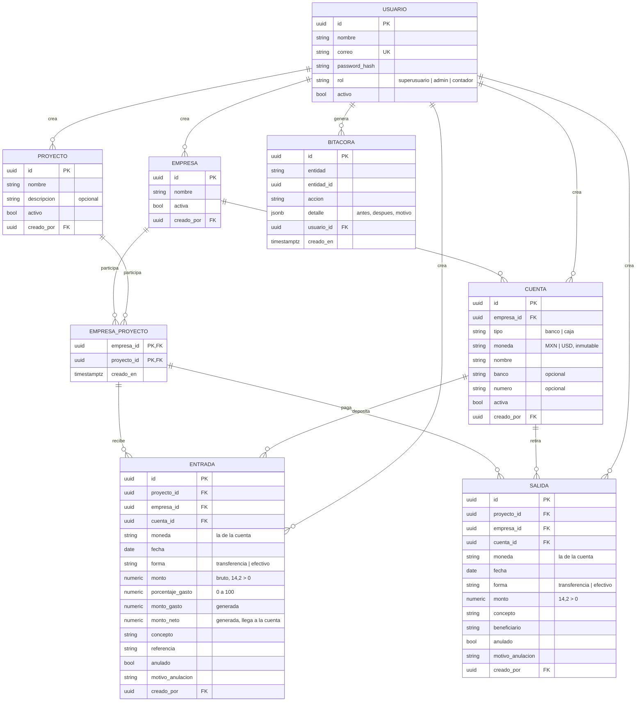

# Control de Empresas y Proyectos — Análisis y modelo de datos

Versión 1.2 · 11 de octubre de 2026 · Implementado (sin traspasos ni saldo inicial; proyectos pueden quedar en negativo; facturas opcionales) · Stack: ver `Stack tecnológico - Control de Clientes.docx` (api-bancaria). Interfaz en blanco y negro.

## 1. Módulos

| # | Módulo | Qué hace |
|---|--------|----------|
| 1 | Acceso | Inicio de sesión (JWT). Roles `superusuario`, `admin` y `contador` |
| 2 | Empresas | Alta solo con nombre; después se le agregan cuentas cuando se quiera |
| 3 | Cuentas | Cuentas de banco y cajas de efectivo de cada empresa, en MXN o USD. Empiezan en cero |
| 4 | Proyectos | Alta solo con nombre; se vinculan a una o varias empresas |
| 5 | Entradas | Dinero que entra a un proyecto, a una empresa y a una cuenta; % de gasto opcional |
| 6 | Salidas | Dinero que sale de un proyecto, desde una empresa y una cuenta |
| 7 | Reportes | Saldos, historial, cuadre, ingresos y gastos, periodo opcional, json/csv/xlsx/pdf |
| 8 | Bitácora | Registro inmutable de todo lo que hace cualquier usuario |

## 2. Usuarios, roles y visibilidad

| Rol | Ve | Puede |
|-----|----|-------|
| `superusuario` | Todo | Todo lo del admin + crear y desactivar administradores. No se puede borrar ni desactivar |
| `admin` | Todo | Capturar, editar y anular cualquier registro; crear y desactivar contadores; consultar la bitácora |
| `contador` | Todo | Capturar cualquier cosa; editar y anular **solo lo que él creó** |

- R1. Todos los usuarios ven todos los datos (empresas, proyectos, cuentas, movimientos y reportes) y pueden usarlos en sus movimientos.
- R2. Cada registro guarda `creado_por` y se muestra en pantalla ("Registrado por"). La bitácora indica qué usuario hizo cada cosa y se puede filtrar por usuario, entidad y fechas.
- R3. **Superusuario inicial**: al arrancar (`python -m app.cli inicializar`), si no existe, se crea con `SUPERUSUARIO_CORREO`, `SUPERUSUARIO_PASSWORD` (mínimo 8 caracteres) y `SUPERUSUARIO_NOMBRE` del entorno. Funciona igual en cualquier servidor (local, Render, Railway). Con `SUPERUSUARIO_RESTABLECER=true` se vuelve a aplicar la contraseña del entorno.
- R4. Contraseñas del resto de usuarios: mínimo 8 caracteres, con letras y números.
- R5. **Bitácora**: se registra todo (altas, cambios, anulaciones, vinculaciones, inicios de sesión) de cualquier usuario, incluido el superusuario. Es inmutable (trigger que rechaza UPDATE y DELETE).

## 3. Reglas de negocio

### Empresas y proyectos
- R6. Empresa y proyecto solo requieren `nombre` (único, sin distinguir mayúsculas, dentro de lo que ve el usuario).
- R7. Relación N:M (`empresa_proyecto`). Al registrar una entrada o salida, si la empresa aún no tiene el proyecto, **se vincula automáticamente**.

### Cuentas
- R8. Cada cuenta pertenece a una empresa y es de tipo `banco` o `caja`.
- R9. La `moneda` (`MXN` o `USD`) se fija al crear y **no se puede cambiar**.
- R10. Varias cuentas de banco por empresa; **una sola caja por moneda**.
- R11. **No hay saldo inicial**: toda cuenta empieza en cero y todo el dinero entra por una entrada de un proyecto. El dinero que ya había al empezar se registra como una entrada (p. ej. concepto «Saldo de apertura») del proyecto al que pertenece.
- R12. El saldo de la cuenta se calcula, no se guarda: `saldo = Σ entradas.monto_neto − Σ salidas.monto`.

### Entradas
- R13. Datos: proyecto, empresa, cuenta (de esa empresa), fecha, forma, monto bruto > 0, porcentaje de gasto (0 a 100, opcional), concepto y referencia opcionales.
- R14. `efectivo` → cuenta tipo `caja`; `transferencia` → cuenta tipo `banco`.
- R15. El gasto se lo queda el proveedor antes de que llegue el dinero. La base de datos calcula:
  - `monto_gasto = round(monto × porcentaje / 100, 2)` → gastos del proyecto.
  - `monto_neto = monto − monto_gasto` → **es lo que llega a la cuenta** y lo que suma al proyecto.
- R16. La moneda es la de la cuenta.

### Salidas
- R17. Datos: proyecto, empresa, cuenta (de esa empresa), fecha, forma, monto > 0, concepto obligatorio, beneficiario opcional. Misma regla de forma ↔ tipo de cuenta.
- R18. **Un proyecto puede quedar en negativo.** Si un proyecto tuvo pérdida, se registra la salida a su nombre aunque no tenga saldo: el dinero sale de la cuenta, donde está el de los otros proyectos. Lo único que se valida es que **la cuenta** alcance (es dinero físico). Lo mismo al editar o anular. Los saldos negativos se muestran en rojo en pantallas, reportes, Excel y PDF.
- R18b. **Factura (opcional)**: entradas y salidas tienen la casilla «requiere factura» y un archivo de factura opcional (PDF, XML, JPG o PNG; se valida por contenido; máximo `MAX_DOCUMENTO_MB`). Se guarda en una carpeta local o en un bucket S3 (`ALMACENAMIENTO`); la BD guarda solo la ruta. Subir o quitar la factura queda en la bitácora. Las listas se filtran por factura requerida, pendiente, adjunta o sin factura.

### Sin traspasos
- R19. No hay traspasos entre cuentas. Para llevar efectivo de la caja al banco se registra una **salida de la caja** y una **entrada sin %** al banco, del mismo proyecto y empresa.
- R20. **Cuadre**: por empresa y moneda, siempre se cumple `Σ entradas (neto) − Σ salidas = Σ saldo de las cuentas = Σ saldo de los proyectos`. El reporte «Cuadre» lo muestra.

### Monedas y correcciones
- R21. MXN y USD nunca se suman: todo se presenta separado por moneda.
- R22. Entradas y salidas no se borran: se **anulan con motivo** y dejan de contar.

## 4. Cálculos

Para un proyecto P, una empresa E y una moneda M (solo movimientos vigentes):

```
ingresos(P, E, M) = Σ entradas.monto_neto
gastos(P, E, M)   = Σ entradas.monto_gasto
salidas(P, E, M)  = Σ salidas.monto
saldo(P, E, M)    = ingresos − salidas          ← puede ser negativo
saldo(P, M)       = Σ_E saldo(P, E, M)
saldo cuentas(E, M) = Σ_P saldo(P, E, M)         ← cuadre
```

## 5. Reportes

Todos aceptan `fecha_desde` y `fecha_hasta` opcionales (sin periodo = todo), separan por moneda y aceptan `?formato=json|csv|xlsx|pdf`. Los ingresos se muestran en **neto**.

| Reporte | Agrupa por | Columnas |
|---------|-----------|----------|
| Saldo por proyecto | proyecto, moneda — **todos los proyectos**, tengan movimientos o no | ingresos, gastos, salidas, saldo (negativo en rojo) |
| Saldo por proyecto y empresa | proyecto, empresa, moneda | ingresos, gastos, salidas, saldo |
| Historial de proyecto | movimiento, por fecha | fecha, tipo, empresa, cuenta, forma, bruto, %, gasto, neto, salida, saldo acumulado |
| Saldo por cuenta | empresa, cuenta | tipo, moneda, (saldo anterior con periodo), entradas, salidas, saldo; totales de cajas, bancos y general por moneda |
| Cuadre | empresa, moneda | entradas, salidas, saldo en cuentas, saldo de proyectos, diferencia (siempre 0), estado — al corte «hasta» |
| Gastos acumulados | moneda | total de gastos |
| Gastos por proyecto | proyecto, moneda | gastos |
| Gastos por empresa | empresa, moneda | gastos |
| Ingresos por proyecto | proyecto, moneda | ingresos netos |
| Ingresos por empresa | empresa, moneda | ingresos netos |

## 6. Diagrama entidad-relación



### Integridad en la base de datos
- `entrada`/`salida (empresa_id, proyecto_id)` → FK compuesta a `empresa_proyecto`.
- `entrada`/`salida (cuenta_id, empresa_id, moneda)` → FK compuesta a `cuenta (id, empresa_id, moneda)`: la cuenta es de esa empresa y el movimiento queda en su moneda.
- `cuenta`: trigger que impide cambiar empresa, tipo o moneda.
- `cuenta`: único parcial `(empresa_id, moneda) WHERE tipo = 'caja'`; CHECK de `tipo` y `moneda`.
- `entrada`: CHECK `monto > 0` y `porcentaje_gasto BETWEEN 0 AND 100`; `monto_gasto` y `monto_neto` como columnas `Computed`.
- Saldos: cada alta, edición o anulación bloquea (SELECT … FOR UPDATE) el proyecto y las cuentas afectadas y verifica que ninguno quede en negativo, así dos capturas simultáneas no pueden rebasar el saldo.
- `usuario`: único parcial que permite un solo `superusuario`.
- `bitacora`: trigger que rechaza UPDATE y DELETE.

## 7. Variables de entorno nuevas

`SUPERUSUARIO_CORREO`, `SUPERUSUARIO_PASSWORD` (≥ 8 caracteres), `SUPERUSUARIO_NOMBRE`, `SUPERUSUARIO_RESTABLECER`, `SEED_DEMO`. El resto, como en el stack.

## 8. Orden de construcción (completado)

1. Esqueleto del monorepo (backend + frontend + Docker + CI), usuarios, roles, superusuario inicial y bitácora.
2. Empresas, proyectos y vínculo automático.
3. Cuentas (banco y caja) con moneda inmutable.
4. Entradas y salidas con validación de saldos (proyecto por empresa y cuenta).
5. Servicio de saldos y reportes con exportación.
6. Pantallas del frontend en blanco y negro.
7. Despliegue.
