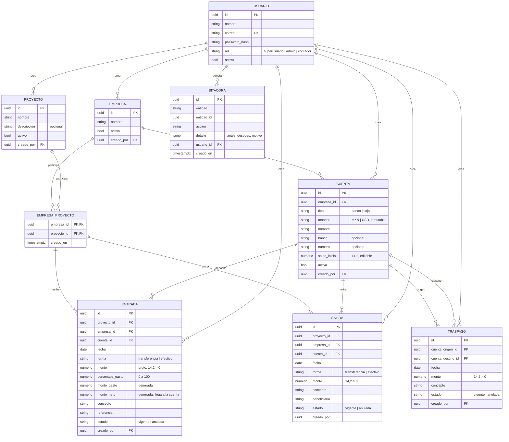

# Control de Empresas y Proyectos — Análisis y modelo de datos

Versión 0.2 · 8 de octubre de 2026 · Stack: ver `Stack tecnológico - Control de Clientes.docx` (api-bancaria). Interfaz en blanco y negro.

## 1. Módulos

| # | Módulo | Qué hace |
|---|--------|----------|
| 1 | Acceso | Inicio de sesión (JWT). Roles `superusuario`, `admin` y `contador` |
| 2 | Empresas | Alta solo con nombre; después se le agregan cuentas cuando se quiera |
| 3 | Cuentas | Cuentas de banco y cajas de efectivo de cada empresa, en MXN o USD, con saldo inicial opcional |
| 4 | Proyectos | Alta solo con nombre; se vinculan a una o varias empresas |
| 5 | Entradas | Dinero que entra a un proyecto, a una empresa y a una cuenta; % de gasto opcional |
| 6 | Salidas | Dinero que sale de un proyecto, desde una empresa y una cuenta |
| 7 | Traspasos | Mover dinero entre cuentas de la misma moneda (p. ej. depositar la caja al banco) |
| 8 | Reportes | Saldos, historial, ingresos y gastos, periodo opcional, json/csv/xlsx/pdf |
| 9 | Bitácora | Registro inmutable de todo lo que hace cualquier usuario |

## 2. Usuarios, roles y visibilidad

| Rol | Ve | Puede |
|-----|----|-------|
| `superusuario` | Todo | Todo lo del admin + crear y desactivar administradores. No se puede borrar ni desactivar |
| `admin` | Todo | Capturar, editar y anular cualquier registro; crear y desactivar contadores; consultar la bitácora |
| `contador` | Todo | Capturar cualquier cosa; editar y anular **solo lo que él creó** |

- R1. Todos los usuarios ven todos los datos (empresas, proyectos, cuentas, movimientos y reportes) y pueden usarlos en sus movimientos.
- R2. Cada registro guarda `creado_por` y se muestra en pantalla ("Registrado por"). La bitácora indica qué usuario hizo cada cosa y se puede filtrar por usuario, entidad y fechas.
- R3. **Superusuario inicial**: al arrancar (`python -m app.cli inicializar`), si no existe, se crea con `SUPERUSUARIO_CORREO`, `SUPERUSUARIO_PASSWORD` (mínimo 8 caracteres) y `SUPERUSUARIO_NOMBRE` del entorno. Funciona igual en cualquier servidor (local, Render, Railway). Con `SUPERUSUARIO_RESTABLECER=true` se vuelve a aplicar la contraseña del entorno.
- R4. Contraseñas del resto de usuarios: mínimo 8 caracteres, con letras y números.
- R5. **Bitácora**: se registra todo (altas, cambios, anulaciones, cambios de saldo inicial, inicios de sesión) de cualquier usuario, incluido el superusuario. Es inmutable (trigger que rechaza UPDATE y DELETE).

## 3. Reglas de negocio

### Empresas y proyectos
- R6. Empresa y proyecto solo requieren `nombre` (único, sin distinguir mayúsculas, dentro de lo que ve el usuario).
- R7. Relación N:M (`empresa_proyecto`). Al registrar una entrada o salida, si la empresa aún no tiene el proyecto, **se vincula automáticamente**.

### Cuentas
- R8. Cada cuenta pertenece a una empresa y es de tipo `banco` o `caja`.
- R9. La `moneda` (`MXN` o `USD`) se fija al crear y **no se puede cambiar**.
- R10. Varias cuentas de banco por empresa; **una sola caja por moneda**.
- R11. `saldo_inicial` es opcional (0 por defecto) y se puede asignar o corregir en cualquier momento; cada cambio pide motivo y queda en la bitácora.
- R12. El saldo de la cuenta se calcula, no se guarda:
  `saldo = saldo_inicial + Σ entradas.monto_neto − Σ salidas.monto + Σ traspasos recibidos − Σ traspasos enviados`.

### Entradas
- R13. Datos: proyecto, empresa, cuenta (de esa empresa), fecha, forma, monto bruto > 0, porcentaje de gasto (0 a 100, opcional), concepto y referencia opcionales.
- R14. `efectivo` → cuenta tipo `caja`; `transferencia` → cuenta tipo `banco`.
- R15. El gasto se lo queda el proveedor antes de que llegue el dinero. La base de datos calcula:
  - `monto_gasto = round(monto × porcentaje / 100, 2)` → gastos del proyecto.
  - `monto_neto = monto − monto_gasto` → **es lo que llega a la cuenta** y lo que suma al proyecto.
- R16. La moneda es la de la cuenta.

### Salidas
- R17. Datos: proyecto, empresa, cuenta (de esa empresa), fecha, forma, monto > 0, concepto obligatorio, beneficiario opcional. Misma regla de forma ↔ tipo de cuenta.
- R18. No se puede sacar más de lo disponible: deben alcanzar el saldo del proyecto en esa moneda **y** el saldo de la cuenta.

### Traspasos
- R19. De una cuenta origen a una cuenta destino distintas, **misma moneda**, monto > 0, fecha y concepto. Pueden ser de la misma empresa o de empresas distintas (ambas visibles para el usuario).
- R20. El origen debe tener saldo suficiente. No afecta saldos de proyectos, solo de cuentas.

### Monedas y correcciones
- R21. MXN y USD nunca se suman: todo se presenta separado por moneda.
- R22. Entradas, salidas y traspasos no se borran: se **anulan con motivo** y dejan de contar.

## 4. Cálculos

Para un proyecto P y una moneda M (solo movimientos vigentes):

```
ingresos(P, M) = Σ entradas.monto_neto
gastos(P, M)   = Σ entradas.monto_gasto
salidas(P, M)  = Σ salidas.monto
saldo(P, M)    = ingresos − salidas
```

Lo mismo agrupando por empresa o en total. Los saldos iniciales y los traspasos solo afectan a las cuentas.

## 5. Reportes

Todos aceptan `fecha_desde` y `fecha_hasta` opcionales (sin periodo = todo), separan por moneda y aceptan `?formato=json|csv|xlsx|pdf`. Los ingresos se muestran en **neto**.

| Reporte | Agrupa por | Columnas |
|---------|-----------|----------|
| Saldo por proyecto | proyecto, moneda | ingresos, gastos, salidas, saldo |
| Historial de proyecto | movimiento, por fecha | fecha, tipo, empresa, cuenta, forma, bruto, %, gasto, neto, salida, saldo acumulado |
| Saldo por cuenta | empresa, cuenta | tipo, moneda, saldo inicial, entradas, salidas, traspasos, saldo; subtotales caja / banco por empresa y moneda; total general por moneda |
| Gastos acumulados | moneda | total de gastos |
| Gastos por proyecto | proyecto, moneda | gastos |
| Gastos por empresa | empresa, moneda | gastos |
| Ingresos por proyecto | proyecto, moneda | ingresos netos |
| Ingresos por empresa | empresa, moneda | ingresos netos |

## 6. Diagrama entidad-relación



### Integridad en la base de datos
- `entrada`/`salida (empresa_id, proyecto_id)` → FK compuesta a `empresa_proyecto`.
- `entrada`/`salida (cuenta_id, empresa_id)` → FK compuesta a `cuenta (id, empresa_id)`.
- `cuenta`: único parcial `(empresa_id, moneda) WHERE tipo = 'caja'`; CHECK de `tipo` y `moneda`.
- `entrada`: CHECK `monto > 0` y `porcentaje_gasto BETWEEN 0 AND 100`; `monto_gasto` y `monto_neto` como columnas `Computed`.
- `traspaso`: CHECK `cuenta_origen_id <> cuenta_destino_id` y `monto > 0`; la misma moneda se valida en el servicio (y con trigger).
- `usuario`: único parcial que permite un solo `superusuario`.
- `bitacora`: trigger que rechaza UPDATE y DELETE.

## 7. Variables de entorno nuevas

`SUPERUSUARIO_CORREO`, `SUPERUSUARIO_PASSWORD` (≥ 8 caracteres), `SUPERUSUARIO_NOMBRE`, `SUPERUSUARIO_RESTABLECER`. El resto, como en el stack.

## 8. Orden de construcción

1. Esqueleto del monorepo (backend + frontend + Docker + CI), usuarios, roles, superusuario inicial y bitácora.
2. Empresas, proyectos y vínculo automático.
3. Cuentas (banco y caja), moneda inmutable y saldo inicial editable.
4. Entradas, salidas y traspasos con validación de saldos.
5. Servicio de saldos y reportes con exportación.
6. Pantallas del frontend en blanco y negro.
7. Despliegue.
